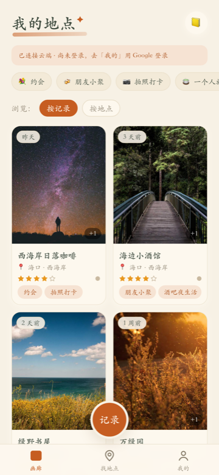
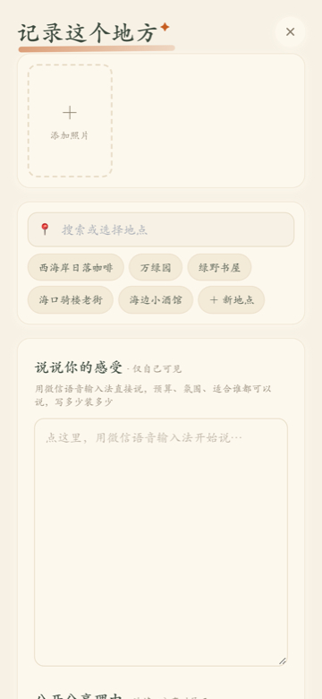
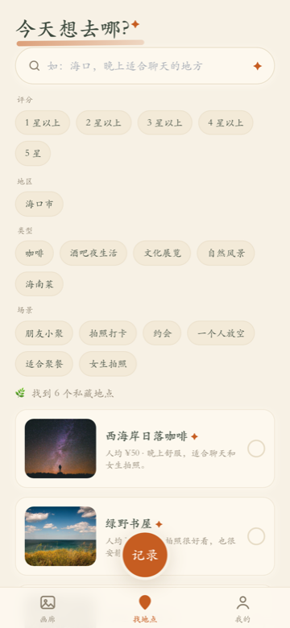
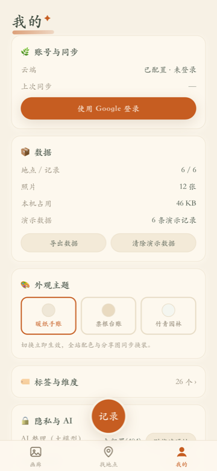

# My Places · Private Check-in Journal

> Places you've been: snap a photo, jot a feeling, and get a journal you can browse, search, and share.

[简体中文](./README.md) | English

Live site: https://place-journal-xi.vercel.app (open it in a mobile browser, or install it to your home screen). The same repository also ships an **Android app** (`mobile/`); sign in with one account and both ends show the same records.

<p>
  
  
  
  
</p>

## What is this

A place journal that stays yours. Every time you visit somewhere, add a few photos and say what you thought of it; the app sorts everything by place, tag, and time. Later, find "that cafe by the seaside last year" with one plain sentence. Want to tell a friend about a trip? Generate a card or a link — private notes don't ride along.

For people who like tracking places they've visited and looking back at life through them. Data lives on your own device first and only syncs to the cloud after you sign in; everything works without an account too.

## Core features

- **Log a visit**: multiple photos plus long notes; dictate with your keyboard's voice input; pick a cover and tap any photo to view it full size.
- **AI tidies up**: turns what you said into place, tags, a one-line summary, and a public share reason — nothing is saved until you confirm. Without an AI key it still pre-fills locally.
- **Browse by place**: gallery, per-place timeline, tag and dimension filters.
- **Find in plain words**: natural-language search combined with rating / area / type / occasion filters, e.g. "cafe with a terrace".
- **Share without leaking privacy**: single-place card, multi-place list, and map overview; shares are read-only snapshots, private notes stay out by default, revocable anytime.
- **Offline first, two ends in sync**: records stay on-device when you're offline and upload later; sync progress, pending uploads, and conflict resolution are all visible under "Mine".
- **Reskin without losing anything**: the web app has three palettes (warm paper / ticket stub / bamboo green); Android has light / dark / follow-system. Switching applies instantly and keeps your state.

## Quick start

Web app (PWA):

```bash
npm install
npm run dev        # http://localhost:5173
```

First launch seeds 6 labeled demo places; clear them with one tap under "Mine → Clear demo data".

Production build preview:

```bash
npm run build && npm run preview -- --port 4175
```

Android app (Expo + React Native):

```bash
cd mobile
npm install
npm run android    # with a device or emulator connected
```

For your own install package: `cd mobile/android && ./gradlew assembleRelease`; the APK lands in `mobile/android/app/build/outputs/apk/release/`.

## Configuration

Copy `.env.example` to `.env.local` and fill in real values (restart dev afterwards; changing a `VITE_` variable requires rebuilding the Docker image). Real keys only ever go into `.env.local` and Vercel environment variables — never into Git.

| Variable | Purpose | If left empty |
|---|---|---|
| `VITE_SUPABASE_URL` / `VITE_SUPABASE_PUBLISHABLE_KEY` | Cloud sync + sign-in (only these two belong in the browser) | Local-only use, no cross-device sync |
| `VITE_AMAP_KEY` / `VITE_AMAP_SECURITY_JSCODE` | Map tiles (AMap) | Shows a schematic placeholder map |
| `AI_PROVIDER_ORDER` | AI fallback order: openrouter / deepseek / opencode | Local heuristic pre-fill |
| `OPENROUTER_API_KEY` / `DEEPSEEK_API_KEY` / `OPENCODE_API_KEY` + `OPENCODE_BASE_URL` + `OPENCODE_MODEL` | Server-side AI key (any one is enough) | Same as above |

On Android you only need `EXPO_PUBLIC_*` in `mobile/.env` (see `mobile/.env.example`): the cloud URL and the AI endpoint. AI keys stay server-side and never reach the client.

"Mine → AI connectivity test" verifies the AI path with one tap.

## Deployment

- **Vercel**: import this repo → fill environment variables per `.env.example` → deploy. Then add the production domain to the Supabase Auth callback allow-list and the AMap key domain allow-list. `vercel.json` is already in the repo.
- **Self-hosted Docker**: see `compose.yaml` (port 8081 by default); pass `VITE_*` variables at build time.

## Repository layout

- `src/`: web app (React 18 + TypeScript + Vite + Tailwind; vite-plugin-pwa handles offline and install)
- `mobile/`: Android app (Expo SDK 57 + React Native 0.86.3, local database via expo-sqlite)
- `api/`: serverless endpoints deployed on Vercel (AI organizing)
- `supabase/`: cloud schema migrations

## More docs

- Product and technical plan: `docs/V1_PRODUCT_AND_TECHNICAL_PLAN.md`
- Current status snapshot: `docs/handoff/HANDOFF.md`
- Getting and setting AI keys: `docs/AI模型Key配置丨2026-09-20.md`
- Android notes: `mobile/docs/`

## Known limits

- Voice transcription and cover OCR were removed on purpose; dictate through your keyboard instead.
- Maps need an AMap key plus domain allow-listing, otherwise only a placeholder map shows.
- When the same record is edited on several devices, the newest update wins; resolve it under "Mine → Conflicts".
- Android is distributed as a self-built APK only; it is not on any app store.
