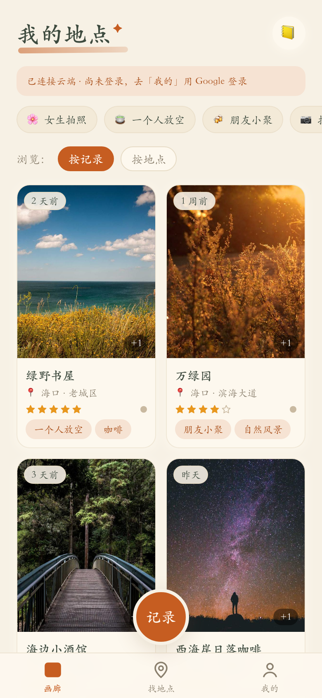
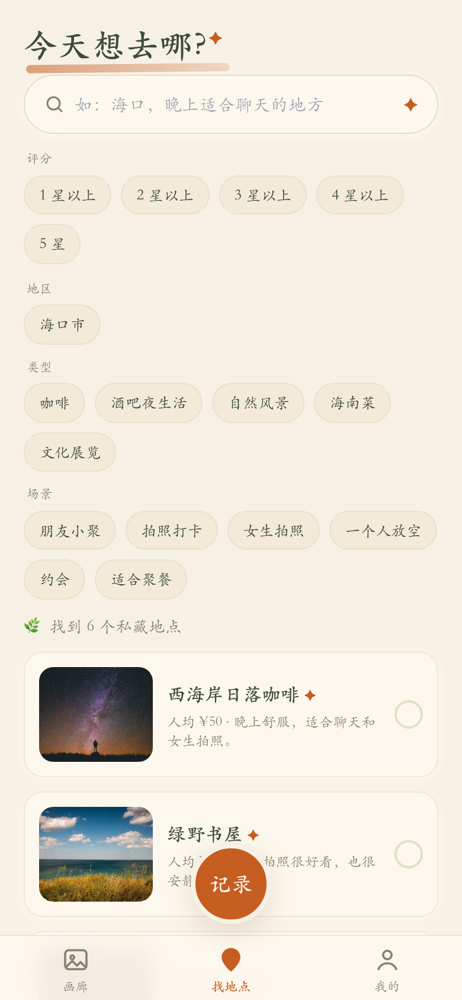
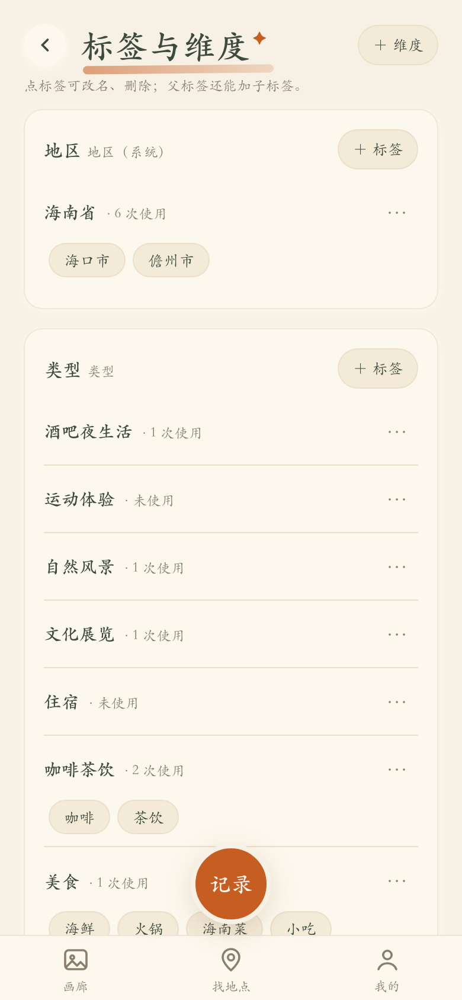

# My Places · Private Check-in Journal

> Places you've been: snap a photo, jot a feeling, and get a journal you can browse, search, and share.

[简体中文](./README.md) | English

Live site: https://place-journal-xi.vercel.app (open in a mobile browser; use "Add to Home Screen" to install it as an app)

<p>
  
  
  
</p>

## What is this

A mobile-first private place journal (PWA, a web app you can install to your phone's home screen). Each time you visit a place, add a few photos and some notes, and the app organizes everything by place, tag, and time. Later, find "that quiet cafe" with a plain sentence; share a trip as a card or link without leaking private notes.

For people who like keeping track of places they've visited. Data lives in the browser first (IndexedDB), and syncs to the cloud (Supabase) after sign-in.

## Core features

- **Log a visit**: multiple photos + long notes, voice input via phone keyboard; cover pick and full-screen photo viewer.
- **AI tidies up**: suggests place, tags, and a one-line summary for you to confirm; works with local guesses when no API key is set.
- **Browse by place**: gallery, per-place timeline, tag filters.
- **Find in plain words**: natural-language search plus structured filters, e.g. "cafe with a terrace".
- **Share without leaking privacy**: single-place card, multi-place list, and map overview; shares are read-only snapshots, private notes stay out by default, revocable anytime.
- **Works offline**: records stay on-device first, sync when online; sync status and pending uploads are visible under "Mine".

## Quick start

```bash
npm install
npm run dev        # http://localhost:5173
```

The first launch seeds 6 labeled demo places; clear them with one tap under "Mine".

Production build preview:

```bash
npm run build && npm run preview -- --port 4175
```

## Configuration

Copy `.env.example` to `.env.local` and fill in real values (restart dev afterwards; changing a `VITE_` variable requires rebuilding the Docker image). Real keys go only in `.env.local` and Vercel env vars, never in Git.

| Variable | Purpose | If empty |
|---|---|---|
| `VITE_SUPABASE_URL` / `VITE_SUPABASE_PUBLISHABLE_KEY` | Cloud sync + sign-in (only these two in the browser) | Local-only, no cross-device sync |
| `VITE_AMAP_KEY` / `VITE_AMAP_SECURITY_JSCODE` | Map tiles (AMap) | Placeholder map |
| `AI_PROVIDER_ORDER` | AI provider fallback order: openrouter / deepseek / opencode | Local guesses only |
| `OPENROUTER_API_KEY` / `DEEPSEEK_API_KEY` / `OPENCODE_API_KEY` + `OPENCODE_BASE_URL` + `OPENCODE_MODEL` | Server-side AI keys (any one works) | Same as above |

Use "Mine → AI connectivity test" in the app to verify the AI link.

## Deploy

- **Vercel**: import this repo → fill env vars per `.env.example` → deploy. Then add the production URL to the Supabase Auth callback allowlist and the AMap key domain allowlist. `vercel.json` is included.
- **Self-hosted Docker**: see `compose.yaml` (default port 8081); pass `VITE_*` vars at build time.

## Further docs

- Product & technical plan: `docs/V1_PRODUCT_AND_TECHNICAL_PLAN.md`
- Current status snapshot: `docs/handoff/HANDOFF.md`
- AI key setup (Chinese): `docs/AI模型Key配置丨2026-09-20.md`

## Known limits

- Voice transcription and cover OCR were removed by design; use the phone keyboard's voice input instead.
- Maps need an AMap key with the domain allowlisted, otherwise a placeholder map is shown.
- When two devices edit the same record, the newer `updated_at` wins; resolve conflicts under "Mine → conflict resolution".
